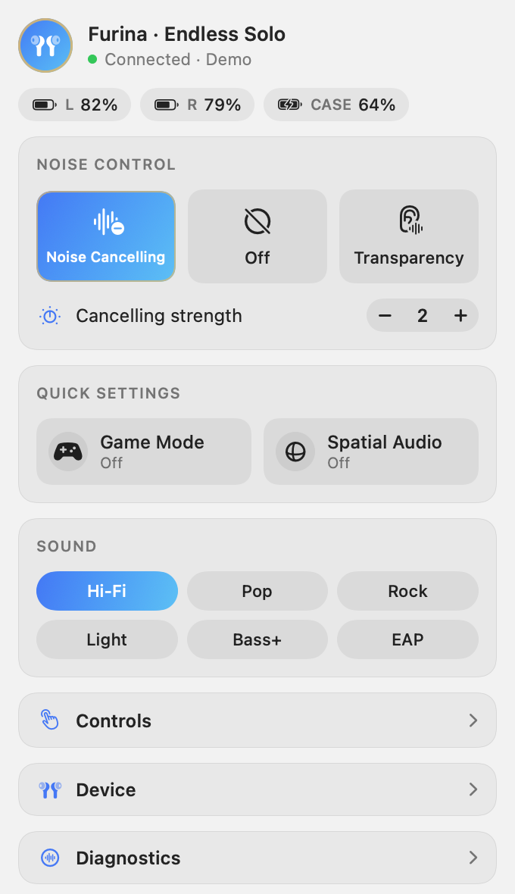
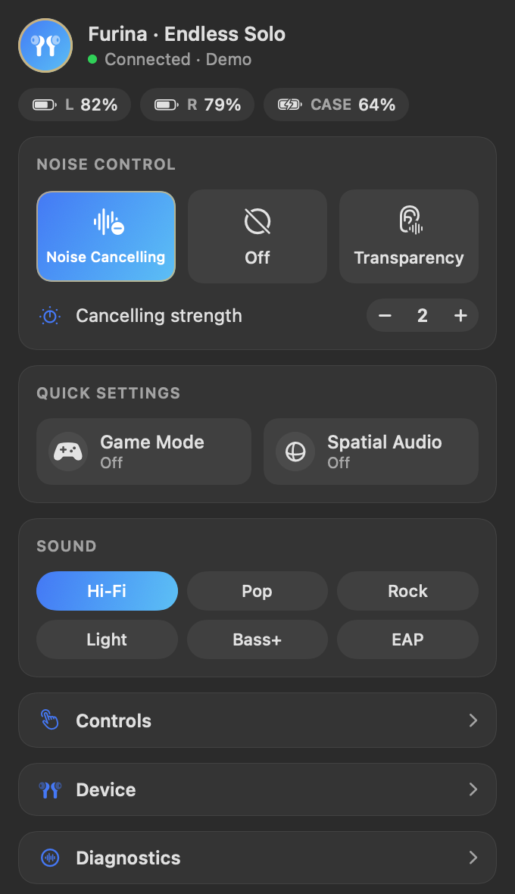

# Furibar

A macOS menu bar app for the **Genshin Impact Furina "Endless Solo" earbuds** by Roseselsa / ROSE TECHNICS. It does what the RoseLink phone app does for everyday settings, from your Mac's menu bar, and never touches the internet.

<p>
  
  
</p>

*Rendered from Demo mode with `swift run furibar-snapshots`.*

## Features

- **Battery** for the left and right earbuds and the case, with the lower earbud level in the menu bar
- **Noise control:** Noise Cancelling, Off and Transparency, plus their levels
- **Quick settings:** Game mode and Spatial audio
- **Sound:** EQ presets
- **Controls:** touch controls and in-ear detection
- **Device:** voice prompt language and volume, multipoint, find my earbuds, firmware version
- **Diagnostics:** every raw value the earbuds report, a live traffic log, a connection log (also when it can't connect), a raw command sender, and Copy Log
- **Demo mode**, so you can try the app without earbuds (it's off again after a relaunch)
- Connects over Classic Bluetooth or Bluetooth LE, whichever works, and reconnects on its own
- Only connects on its own to **your** earbuds: ones paired with this Mac, or ones you picked before. Other Roseselsa earbuds nearby are listed for you to choose, never connected to silently

The panel only shows settings your earbuds actually report.

## Privacy

Furibar has no account, no analytics, no cloud features and no networking code. The app is signed with the macOS App Sandbox and only the Bluetooth entitlement, so macOS blocks network access even if code tried to use it. Settings stay in your Mac's UserDefaults.

## Build and run

Requirements: macOS 14 or later and Swift 6.3 (the Xcode Command Line Tools are enough).

```sh
scripts/build-app.sh          # builds build/Furibar.app and build/Furibar.zip
open build/Furibar.app
```

The first time it connects, macOS asks for Bluetooth access. Click Allow. To start at login, use the gear menu in the panel; this works best with the app in `/Applications`.

To try it without earbuds, turn on **Demo mode** in the gear menu, or run `open build/Furibar.app --args --demo`.

If your earbuds show up under **Nearby** instead of connecting, click **Connect** next to them. Furibar remembers the choice; **Forget Chosen Earbuds** in the gear menu undoes it.

### Building on another Mac

If you build on a machine without Bluetooth (for example a virtual Mac), copy `build/Furibar.zip` to the Mac that has the earbuds:

```sh
scp user@build-mac:path/to/furibar/build/Furibar.zip ~/Downloads/
cd ~/Downloads && unzip -o Furibar.zip && open Furibar.app
```

The app is ad-hoc signed. If macOS says it can't be opened, open **System Settings → Privacy & Security**, scroll down and click **Open Anyway**. Or clear the download flag in Terminal:

```sh
xattr -dr com.apple.quarantine Furibar.app
```

## Development

```sh
scripts/test.sh                      # unit tests (Swift Testing)
swift run furibar-snapshots          # renders the panel to build/snapshots/*.png
```

| Part | What it holds |
| --- | --- |
| `Sources/FuribarCore` | Protocol framing, device state, the command session, model recognition, the demo earbuds. No Bluetooth or UI, fully unit-tested. |
| `Sources/FuribarApp` | SwiftUI panel, connection manager, CoreBluetooth and IOBluetooth links |
| `Sources/Furibar` | App entry point |
| `Tools/Snapshots` | Renders the panel to PNGs for design checks |
| `Support` | `Info.plist` and entitlements used by `scripts/build-app.sh` |

## Protocol status

The protocol comes from a static analysis of the RoseLink Android app and **hasn't been verified against real earbuds yet**. The battery and firmware layouts, some on/off polarities, and the find-device sides are educated guesses. Diagnostics exists to check them. See [docs/protocol.md](docs/protocol.md) for details and what's not implemented.

Furibar is an unofficial project, not affiliated with Roseselsa, ROSE TECHNICS or HoYoverse.
